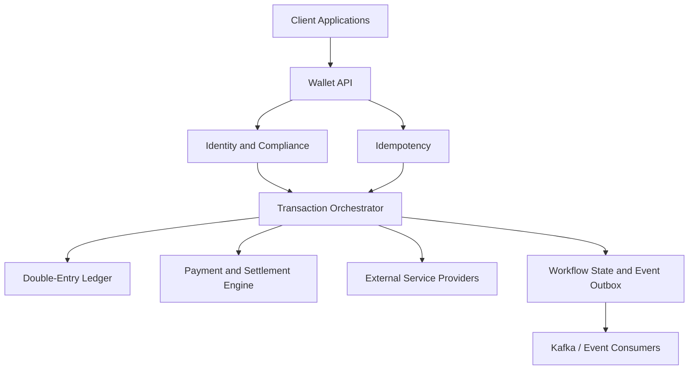

# Wallet Engine
### A Java Backend for Distributed Wallet and Payment Workflows

[](https://spring.io/projects/spring-boot)
[](https://maven.apache.org/)

**Repository:** [gregomebije1/wallet-engine](https://github.com/gregomebije1/wallet-engine)

## Overview

Wallet Engine is a Java backend project exploring the design of a customer-facing orchestration service for digital financial transactions.

The service coordinates wallet operations across a distributed double-entry ledger, payment and settlement services, and external providers. Rather than maintaining the authoritative financial balance locally, the wallet service delegates financial posting and balance integrity to the ledger service.

The project focuses on backend engineering challenges that arise when financial operations span multiple services: transaction consistency, duplicate requests, concurrent operations, external service failures, compliance limits and asynchronous processing.

- If one service succeeds and another fails, what should happen next? Which compensation actions are safe to retry?


### Engineering objectives

- Separate customer-facing wallet operations from authoritative ledger accounting.
- Design transaction workflows that remain understandable and recoverable when downstream services fail.
- Prevent duplicate requests from causing unintended financial operations.
- Enforce transaction limits based on customer verification tiers.
- Support integrations with payment providers and external service networks.
- Define clear API contracts and test important failure and concurrency scenarios.

## Architecture

The wallet service acts as an orchestration layer rather than the system of record for money.


### Architectural responsibilities

| Component | Responsibility |
|---|---|
| Wallet API | Accept and validate client requests |
| Compliance layer | Apply verification-tier and transaction-limit rules |
| Idempotency layer | Identify repeated requests and prevent duplicate execution |
| Transaction orchestrator | Coordinate multi-stage operations and recovery |
| Double-entry ledger | Maintain authoritative financial postings and balances |
| Payment and settlement services | Integrate payment collection, clearing and settlement |
| Event publishing | Communicate transaction outcomes to downstream consumers |

## Key engineering challenges

### 1. Financial integrity and ledger separation

The wallet service does not own the authoritative balance database. Financial postings are delegated to a separate double-entry ledger service.

This separation establishes a clear boundary between customer-facing workflows and the accounting system of record.

The intended design requires:

- Financial operations to be recorded by the ledger rather than by independently updating a wallet balance.
- Successful operations to be associated with ledger transaction references.
- Failed operations to have explicit outcomes and recovery paths.
- Transaction amounts to use defined monetary units and currency rules.

The ledger service is responsible for enforcing its accounting invariants. The wallet service must not assume that a request succeeded financially merely because an HTTP call was initiated.

### 2. Idempotent request handling

Financial APIs may receive duplicate requests because of client retries, network timeouts or repeated submissions.

The design includes an idempotency layer using request keys, payload validation and stored request outcomes.

Expected behaviour:

- A repeated key with the same request should not create a second financial operation.
- Reuse of a key with a different payload should be rejected.
- Concurrent requests using the same key should not execute independently.
- The service should define how in-progress requests, failed attempts and expired keys are handled.

Redis-based distributed coordination is a potential implementation for this layer. The exact locking and recovery strategy should be documented alongside the implemented code.

### 3. Distributed transaction orchestration

Some wallet operations span several independent systems. For example, a utility purchase may require a ledger hold, an external provider request and a final ledger capture.

The proposed workflow is:

1. Validate the request and applicable transaction limits.
2. Establish an idempotent operation reference.
3. Place a hold on funds through the ledger.
4. Call the external provider.
5. Capture the hold after confirmed success, or release it after a confirmed failure.
6. Persist the final outcome and publish relevant events.

The architecture uses the **Saga pattern** to model multi-stage workflows and compensating actions.

A compensation is a new business operation that counteracts an earlier operation; it is not a database rollback across independent services. Where an external provider's outcome is uncertain, the workflow must reconcile that outcome before releasing or reversing funds.

Temporal is a candidate workflow orchestration technology for durable execution and recovery.

### 4. Compliance and transaction limits

The proposed compliance layer supports customer verification tiers with configurable transaction and daily-volume limits.

Limits are represented as integer monetary units to avoid floating-point rounding errors in financial calculations.

The design considers:

- Per-transaction limits.
- Daily transaction-volume limits.
- Customer verification status.
- Rejection of requests that exceed configured limits.
- Consistent enforcement when requests arrive concurrently.

Daily-limit enforcement requires concurrency-safe aggregation or reservation of transaction capacity. A simple read-then-insert check can allow concurrent requests to exceed the configured limit unless the operation is appropriately synchronised.

### 5. Event-driven integration

The architecture includes an event outbox to coordinate the persistence of business outcomes with asynchronous event publication.

Potential event consumers include notification services, audit workflows and downstream transaction-processing systems.

The intended outbox flow is:

1. Persist the relevant business state and outbox event in the same database transaction.
2. Publish undispatched events asynchronously.
3. Mark events as dispatched after successful publication.
4. Handle retries and duplicate delivery safely.

The outbox pattern supports reliable event publication, but does not itself guarantee exactly-once processing by every downstream consumer.

## API design

The project defines REST API contracts for the following wallet operations.

| Endpoint | Purpose |
|---|---|
| `POST /api/v1/wallets/accounts` | Provision a wallet account linked to a ledger account |
| `POST /api/v1/wallets/funding/intent` | Initiate wallet funding through a payment provider |
| `POST /api/v1/wallets/funding/webhook/{provider}` | Receive provider funding notifications |
| `POST /api/v1/transfers/outbound` | Initiate an external payout |
| `POST /api/v1/transactions/p2p` | Initiate a peer-to-peer wallet transfer |
| `POST /api/v1/vas/purchase` | Purchase airtime, data or utility services |

These endpoints describe the intended API surface. Refer to the implemented controllers and API tests for the currently supported behaviour.

### Example: Peer-to-peer transfer

`POST /api/v1/transactions/p2p`

Request:

```json
{
  "sender_wallet_id": "wallet-sender",
  "receiver_wallet_id": "wallet-receiver",
  "amount": 2500,
  "currency": "USD",
  "narration": "Dinner split"
}
```

The request should be authenticated, validated and processed through an idempotent transaction workflow. The ledger service remains responsible for posting the corresponding debit and credit entries.

The API contract should specify the monetary unit, accepted currencies, response status, transaction lifecycle and behaviour when the result is pending or uncertain.

## Data model

The proposed PostgreSQL schema separates customer metadata and workflow state from authoritative ledger balances.

Principal entities include:

- `user_profiles` — customer references and verification information.
- `wallets` — wallet identifiers and external ledger account references.
- `compliance_limits` — transaction and daily-volume thresholds.
- `distributed_idempotency_registry` — request keys and stored outcomes.
- `saga_orchestration_logs` — workflow state and downstream references.
- `wallet_funding_intents` — funding requests and provider references.
- `vas_transactions` — value-added service transaction metadata.
- `ewallet_outbox_events` — events awaiting asynchronous publication.

Database constraints, appropriate indexes and transactional boundaries are essential to enforcing invariants under concurrent access.

Sensitive customer information requires a deliberate encryption and key-management strategy. Encryption keys should not be hard-coded in source code or committed to version control.

## Testing strategy

Testing focuses on financial correctness, concurrency and distributed failure handling.

### Concurrent transaction attempts

The repository includes a Java concurrency test using `CountDownLatch`, `ExecutorService`, atomic counters and mocked dependencies.

The scenario submits 50 concurrent requests to simulate attempts to spend $10 from an initial $100 balance.

Expected outcome:

- 10 successful deductions.
- 40 rejected deductions.
- No negative remaining balance.

This test exercises concurrent request execution and the simulated balance guard.

**Important limitation:** because the supplied test uses mocks and an in-memory atomic counter, it does not establish that concurrent database transactions, distributed locks or the external ledger are safe under real contention. Database-backed integration tests are needed to validate those guarantees.

### Additional test scenarios

The intended test suite should also cover:

- Duplicate requests with identical idempotency keys.
- Reuse of an idempotency key with a different payload.
- Insufficient funds and concurrent balance updates.
- Downstream timeouts and ambiguous provider outcomes.
- Saga compensation after a failed workflow step.
- Duplicate or out-of-order payment webhooks.
- Compliance limits at transaction and daily-volume boundaries.
- Outbox retries and duplicate event delivery.

Tests should verify both successful outcomes and the state left behind after failures.

## Technology choices

| Area | Technology |
|---|---|
| Language | Java |
| Application framework | Spring Boot |
| Relational database | PostgreSQL |
| Workflow orchestration | Temporal — intended integration |
| Event streaming | Apache Kafka — intended integration |
| Distributed caching | Redis — intended integration |
| Testing | JUnit 5, Mockito, AssertJ |
| Build | Maven |

Technology labels describe intended or referenced components; confirm dependencies and active integrations in the codebase.

## Running the project

Prerequisites:

- A compatible JDK.
- Maven, or the included Maven Wrapper.
- Any external services required by the implemented configuration.

Compile the application:

```bash
./mvnw clean compile
```

Run automated tests:

```bash
./mvnw test
```

Start the application:

```bash
./mvnw spring-boot:run
```

These commands assume the corresponding Maven configuration and application entry point are present. Configure required database connections and secrets using environment-specific configuration rather than committed credentials.

## Future improvements

Potential areas for further development include:

- Database-backed concurrency and integration tests.
- Durable workflow recovery and reconciliation of uncertain provider outcomes.
- Production-ready idempotency storage and key-expiry policies.
- Observability through trace propagation, structured logs and transaction correlation IDs.
- Secure secrets management and a documented customer-data encryption strategy.
- Contract testing for ledger, settlement and external provider integrations.
- Deployment automation and operational documentation.

## Project focus

This project explores the backend engineering principles required to coordinate financial operations across independently failing services, with particular attention to accounting boundaries, idempotency, concurrency, workflow recovery and reliable API behaviour.

The goal is to make financial workflows explicit, testable and easier to reason about as system complexity grows.
====================

## Commands

docker compose up -d 
docker compose down -v
docker exec -it dev-postgres psql -U postgres
\c wallet_engine

psql -h localhost -p 5432 -U postgres


----
./mvnw clean package -DskipTests
----

./mvnw test
./mvnw spring-boot:run
./mvnw spring-boot:run -DskipTests

./mvnw clean test-compile

============
DROP TABLE IF EXISTS flyway_schema_history CASCADE;
DROP TABLE IF EXISTS services CASCADE;
DROP TABLE IF EXISTS service_providers CASCADE;
DROP TABLE IF EXISTS bank_accounts CASCADE;
DROP TABLE IF EXISTS banks CASCADE;
DROP TABLE IF EXISTS wallets CASCADE;
DROP TABLE IF EXISTS users CASCADE;
DROP TABLE IF EXISTS compliance_limits CASCADE;
